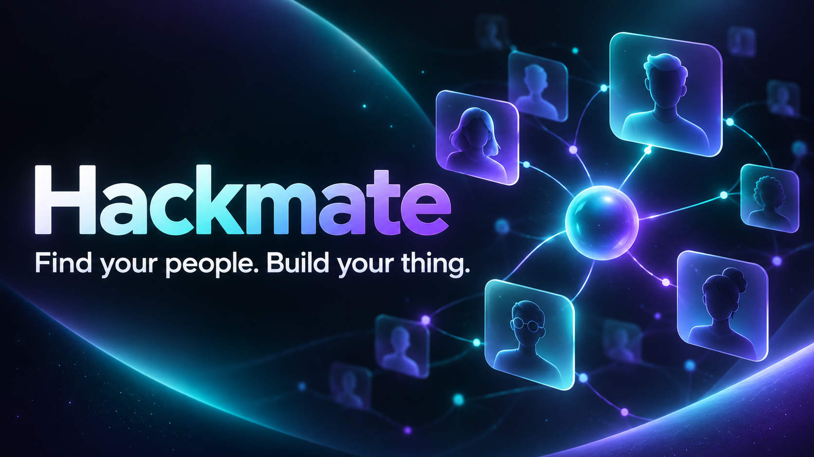

# Hackmate

> Find your people. Build your thing.

[](https://hackmate-build-together.varsham-even-1821.chatgpt.site)
[](https://www.typescriptlang.org/)
[](#responsive-design)



Hackmate is a mobile-first teammate discovery and collaboration app for hackathons and competitions. It helps students find compatible builders, assemble balanced teams, discover events, and coordinate their work without switching between disconnected tools.

## Live demo

**[Launch Hackmate](https://hackmate-build-together.varsham-even-1821.chatgpt.site)**

The demo includes realistic sample data and stores interactive changes on the current device.

## What works

- **Explainable teammate matching** based on skill gaps, interests, and availability
- **Search and filters** for roles, skills, experience, and availability
- **Team invitations** with persistent demo state
- **Competition discovery** with bookmarks and interest tracking
- **Private team workspace** with chat, tasks, deadlines, and shared project links
- **Builder profiles** with skills, availability, verification, and team-seeking status
- **Notifications** for invitations, messages, and deadlines
- **Independent application routes** with working refresh and browser navigation
- **Installable app metadata** for a mobile-app-like experience

## Application routes

| Route | Experience |
| --- | --- |
| `/` | Personalized team readiness dashboard |
| `/discover` | Teammate recommendations, search, and invitations |
| `/events` | Hackathon discovery, bookmarks, and interest tracking |
| `/team` | Team chat, task board, and project links |
| `/profile` | Skills, preferences, availability, and collaboration status |

## Design system

Hackmate uses a dark violet-and-teal visual language with layered glass surfaces, luminous status accents, accessible contrast, responsive cards, and a mobile bottom navigation dock.

### Responsive design

- Desktop: persistent sidebar and multi-column workspaces
- Mobile: compact header, single-column content, and five-tab bottom navigation
- Keyboard-visible focus states and reduced-motion support

## Tech stack

- React 19
- TypeScript 5.9
- Next-compatible Vinext routing
- Tailwind CSS 4 build pipeline
- Vite 8
- Cloudflare Workers-compatible output
- Local Storage for device-local prototype state

## Run locally

Requirements: Node.js 22.13 or newer.

```bash
git clone https://github.com/varun-66611/hackmate.git
cd hackmate
npm install
npm run dev
```

Open [http://localhost:3000](http://localhost:3000).

## Production build

```bash
npm run build
npm run start
```

## Project structure

```text
app/
├── discover/          # Teammate discovery route
├── events/            # Competition discovery route
├── profile/           # Builder profile route
├── team/              # Collaboration workspace route
├── globals.css        # Responsive glass design system
├── hackmate-app.tsx   # Shared interactive application
├── layout.tsx         # Metadata and application shell
└── manifest.ts        # Installable-app metadata
public/
└── og.png             # Social and README preview
```

## Product roadmap

The current release is a polished functional prototype. The next production layer is designed around:

- Supabase Auth, PostgreSQL, Storage, and Realtime
- Server-enforced team capacity and event eligibility
- FastAPI teammate recommendation service
- Organizer tools, participation verification, and moderation
- Verified post-event collaboration reviews

## Privacy and matching

Match percentages in the interface represent relative team fit for the demo; they are not success probabilities. College verification and self-reported skills are presented separately in the product model.

---

Built for students who would rather spend hackathon weekend building than searching for the right team.
